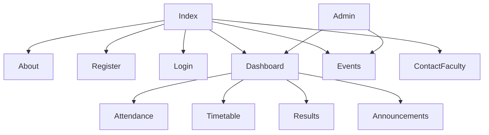

# StudentHub Project

## Overview
StudentHub is a web‑portal prototype for college students to manage their academic life – registration, timetable, attendance, results, events, and faculty contact.  The repository contains **static HTML/CSS/JS** pages for the front‑end and **PHP skeletons** for the back‑end, plus a **MySQL schema** for the required database.

## Project Structure
```
studenthub_user/
├─ index.html
├─ about.html
├─ register.html
├─ login.html
├─ dashboard.html
├─ attendance.html
├─ contactfaculty.html
├─ feedback.html
├─ events.html   (fetches JSON data)
├─ profile.html  (placeholder for future profile page)
├─ admin.html    (admin dashboard – RBAC)
├─ CSS/
│   └─ style.css
├─ js/
│   ├─ main.js          # burger menu, theme toggle, misc UI
│   ├─ register.js      # client‑side form validation
│   └─ events.js        # fetch & render events
├─ data/
│   └─ events.json       # sample event data for Practical 6
├─ backend/
│   ├─ db.php            # PDO connection template (Practical 8)
│   ├─ register.php      # server‑side validation, CSV storage (Practical 7)
│   ├─ login.php         # session handling (Practical 10)
│   └─ schema.sql        # MySQL schema (Practicals 8‑9)
├─ README.md
└─ .gitignore
```

## Setup & Local Deployment (XAMPP)
1. **Clone the repository** to `htdocs/StudentHub` (or any Apache document root).
2. **Create the database**:
   ```sql
   CREATE DATABASE studenthub;
   SOURCE backend/schema.sql;
   ```
3. **Configure DB connection** – edit `backend/db.php` with your MySQL credentials.
4. **Start Apache & MySQL** via XAMPP.
5. Open `http://localhost/StudentHub/index.html` in a browser.

## How to Run Each Practical
| Practical | How to Demo |
|-----------|-------------|
| 1 | Open `README.md`, view the sitemap (Mermaid diagram below), and show the folder structure.
| 2 | Inspect the HTML pages – they use semantic tags (`header`, `nav`, `main`, `section`, `footer`).
| 3 | Resize the browser – the layout switches to a single column on < 768 px (media queries).
| 4 | Click the **burger menu** on mobile, toggle **dark / light mode**, open the FAQ accordion (future implementation).
| 5 | Try registering – client‑side validation will prevent bad input and show inline messages.
| 6 | Open **Events** page – JSON is fetched, rendered, and can be filtered via the search box.
| 7‑10 | Submit the registration form – data is sent to `backend/register.php` (CSV) and login uses PHP sessions.
| 8‑9 | Database tables are created from `schema.sql`; passwords are hashed with `password_hash()`.
| 11‑14 | Admin dashboard (`admin.html`) reads data from the DB, shows stats, and enforces role‑based access.
| 15 | All pages work together; the repo can be pushed to GitHub and deployed locally.

## Sitemap (Mermaid)


## Wireframe (Placeholder)
*Insert low‑fidelity wireframe screenshots here (e.g., drawn in Figma or Draw.io).*  

---
### Practical 15 – Final Integration & Deployment

**What’s completed**
- Full CRUD for **students** and **events** via clean JSON APIs (`api/student.php`, `api/event.php`).
- Admin dashboard (`admin.php`) with RBAC, dynamic navigation, statistics cards, and audit‑log recording.
- Poster upload handling, file‑system cleanup, and audit logging for every admin action.
- Responsive UI, dark/light theme, burger menu – works on mobile and desktop.
- Comprehensive documentation in this README, including local deployment steps.

**Local deployment guide**
1. **Install XAMPP** (or any Apache + MySQL stack). Ensure Apache and MySQL are running.
2. **Create the database**:
   ```sh
   mysql -u root -p < backend/schema.sql
   ```
3. **Configure DB connection** – edit `backend/db.php` with your MySQL credentials.
4. **Start the built‑in PHP server** (optional, for quick testing):
   ```sh
   cd C:/Users/RAHI/OneDrive/Documents/HTML/studenthub_user
   php -S localhost:8000
   ```
   Then open `http://localhost:8000/index.html`.
5. **Open the site** in a browser:
   - Front‑end pages: `index.html`, `events.html`, etc.
   - Admin dashboard (admin only): `admin.php` – you must be logged in as a user with `role='admin'` (set manually in the DB:
     ```sql
     UPDATE users SET role='admin' WHERE email='admin@example.com';
     ```
   ).
6. **Testing checklist**:
   - Register a new user → login.
   - Verify session timeout (15 min) and *remember‑me* cookie.
   - Add / edit / delete students via the admin UI.
   - Add / edit / delete events with poster images → confirm files appear under `uploads/posters/` and are removed on delete.
   - Check that audit entries appear in `audit_log` table.
   - Switch theme, test burger menu on mobile sizes, and confirm responsive layout.
7. **Push to GitHub** (if desired):
   ```sh
   git init
   git add .
   git commit -m "StudentHub final version – practical 1‑15 complete"
   git remote add origin <your-repo-url>
   git push -u origin master
   ```

**Screenshots** (replace placeholders with actual images):
- `screenshots/home.png` – Home page overview.
- `screenshots/admin-dashboard.png` – Admin dashboard with stats.
- `screenshots/event-list.png` – Event table with poster thumbnails.
- `screenshots/student-list.png` – Student management UI.

**Future work (optional)**
- Implement automatic *remember‑me* token verification on page load.
- Add pagination/search to student and event tables.
- Deploy to a cloud platform (Google Cloud Run, Firebase Hosting with Cloud Functions, etc.).

---
*Created on 2026‑10‑29 by Antigravity – an AI coding assistant.*
